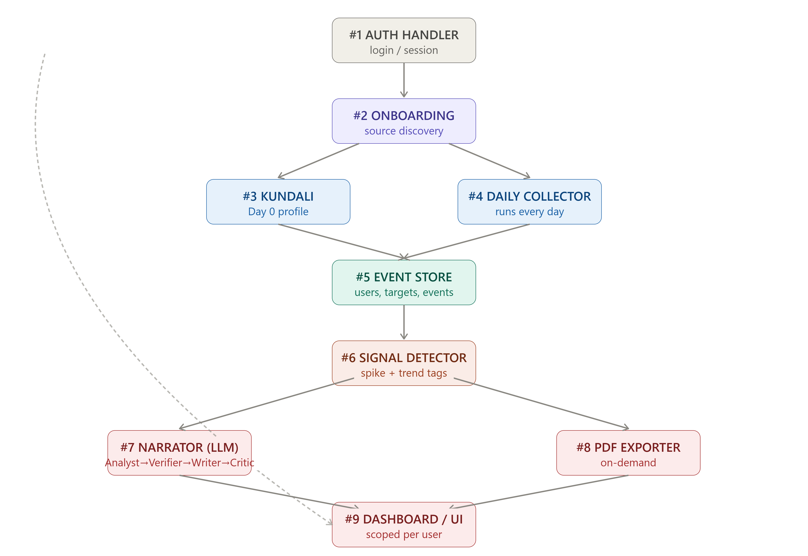

# RAVN — Component Specification

## 1. Auth Handler (Implemented)

- **Trigger:** Sign-up, login, or session validation on each request
- **Input:** User credentials or session token
- **Output:** Hashed/verified passwords, issued session tokens (JWT), validated tokens on protected routes, identified requesting user → scopes every downstream action to that user
- **Feeds:** User identity → Onboarding Handler and Dashboard/UI

---

## 2. Onboarding Handler (Implemented)

- **Trigger:** User submits a company website URL
- **Input:** Company website URL
- **Output:** Confirmed set of source URLs (GitHub org, ATS board, blog, web/social) → handed to Kundali builder; also saved as the target's known sources
- **Feeds:** Confirmed sources → Kundali Builder (background trigger) and Event Store (target registry entry)

---

## 3. Kundali Builder (Implemented)

- **Trigger:** Immediately after onboarding confirmation (runs in background or synchronously via `?sync=true`); target shows "building" in dashboard meanwhile.
- **Input:** Confirmed source URLs for that target (GitHub, ATS/careers, blog, web/social).
- **Process:**
  - Multi-track ingestion across GitHub (repos, commit activity, language byte-counts), ATS APIs / career pages (active job requisitions), technical blogs (RSS/Atom with `trafilatura` HTML article fallback), and web/social snapshots.
  - Multi-provider LLM synthesis pass: requests for `openai/gpt-oss-120b` route to Groq first, then Gemini, then OpenRouter, producing a structured competitive intelligence dossier (`executive_summary`, `strategic_focus_areas`, `cross_signal_correlations`, `predictive_outlook`).
- **Output:** The Day 0 profile — empirical signals (`tech_stack`, 52-week `cadence_baseline`, `recent_commits`, `ats_postings`, `blog_status`, `web_social_status`) and strategic intelligence dossier (`focus_areas`) persisted via idempotent DB upsert.
- **Feeds:** Finished Kundali profile &rarr; database; flips target status to "ready". Accessible via dedicated endpoints: `/targets/{id}/kundali/raw`, `/targets/{id}/kundali/synthesis`, and `/targets/{id}/kundali`.

---

## 4. Daily Collector (Implemented; automated tests added)

Automated `unittest` coverage includes date parsing, source-date boundaries, repeat-run deduplication,
baseline behavior, past-date collection, per-source date parsing, and startup catch-up.

- **Trigger:** Scheduled for 11:59 PM Asia/Kolkata once per day for ready targets, or manually via `POST /targets/{id}/daily/collect`; each source is handled independently.
- **Input:** Target's confirmed source URLs and an Asia/Kolkata calendar date (12:00 AM through 11:59 PM). Repeated manual runs use the same date and deduplicate stored events.
- **Output:** Source-dated commits, job posts, and blog posts; current-day web/social changes; and current-day undated ATS/blog items with first-observed dates. Events carry `date_basis` (`source` or `first_observed`); no LLM synthesis is run in this stage.
- **Feeds:** Dated events must fall on the requested Asia/Kolkata calendar date. The first successful current-day ATS/blog snapshot baselines genuinely undated listings; newly appearing undated listings on later runs are stored with their first-observed time. Known URLs, detail-fetch failures, and candidates beyond the lookup cap are `not_checked`, excluded from event storage and `undated_items`, and counted separately in the collection result. Past-date collection skips undated items and web/social with an explanatory status because those cannot be reconstructed. The daily summary stores per-source status, event count, genuinely undated-item count, and highlight. First-run web snapshots are also baseline.
- **Dates:** The shared `_parse_date` helper handles datetimes, date-only values, ISO strings (including `Z`), RFC-style strings, epoch seconds/milliseconds, and feedparser `struct_time`. Aware timestamps are assigned to the Asia/Kolkata calendar date; naive datetimes are treated as UTC; date-only values keep their date.
- **ATS/blog dates:** Greenhouse `updated_at` is only a candidate pre-filter; the individual job API's `first_published` determines the source date. The HTML ATS fallback reads JSON-LD `JobPosting.datePosted` from unseen job pages, capped at 20 detail lookups per source collection. Blog feeds fall back through `published`, `published_parsed`, `updated`, and `updated_parsed`; HTML article dates come from listing `<time>` metadata or trafilatura article metadata.
- **Highlights:** Each source/date highlight joins up to the three newest event one-liners and reports any remaining event count. It is formatting, not LLM-generated analysis.
- **History:** `GET /targets/{id}/daily/summaries` reads the four highlights for a date; `/daily/summaries/dates` lists dates with stored summary records. Historical baseline-only dates have `baseline_only` status; missing historical summaries report `not_recorded` because collection status cannot be inferred.
- **Current source-date limitation:** The configured ready targets currently resolve to one unique ATS and blog URL (Stripe). A live 2026-11-06 check found source dates for all 6 ATS fallback listings and all 5 blog entries returned in the sample; the previous 2026-11-05 run saw 5/5 ATS and 15/15 blog items without parsed dates before detail-page date extraction. Current-day first-observed dates mean when RAVN noticed an item, not when the employer published it. Past-date runs do not assign current observation times to historical days. These samples should not be generalized to other companies.
- **Tagging boundary:** Events currently receive fixed source/type labels only. Semantic product/topic tagging for the planned weekly spike/trend detector is not implemented. Recommended before detector work: add a separate deterministic tagging step at ingestion with a versioned taxonomy; this is a recommendation, not current behavior.
- **Recovery boundary:** After starting the 23:59 scheduler, the app checks each ready target in a background thread for the latest three completed dates with no daily summary row or with all four sources failed, then collects those gaps. Configure the count with `RAVN_DAILY_CATCHUP_DAYS` (default `3`). Catch-up and scheduled collections share a process-local lock. This is idempotent through daily summaries and event deduplication. Past-date catch-up can recover source-dated GitHub, ATS, and blog items; it skips web/social snapshots and undated first-observed items. It cannot recover source items that have since been removed, and multi-process scheduler ownership has not been configured.

---

## 5. Event Store (Core Implemented; Weekly Storage Planned)

- **Trigger:** None — it's passive, written to by Kundali builder and Daily collector, read by everything else
- **Input:** Target/Kundali records from #3 and daily event records from #4
- **Output now:** On request — paginated event feed with source/date/time filters, single-event detail, and daily source summaries, all scoped to the target owner.
- **Planned:** Week-specific event queries and storage for weekly category counts/digests.
- **Holds now:** User accounts, targets, Kundali profiles, detailed daily events, per-source collection checkpoints, and per-target/date/source summaries.
- **Planned:** Weekly category counts and weekly digests; their tables are not in the current database.

---

## 6. Weekly Signal Detector (Planned)

The planned week runs Monday through Sunday, grouped by each event's `collection_date` in Asia/Kolkata. The weekly job is planned for 03:00 Asia/Kolkata each Monday, after the preceding week has closed. Embedding-based retrieval/vector storage and the LangGraph agent stage are also planned; none is implemented yet.

- **Trigger:** Scheduled, once per week per target, always runs regardless of activity level
- **Input (planned):** That week's events after semantic tagging is defined and implemented, plus the last 4–6 weeks' stored category counts for trend comparison. Current fixed source/type labels do not supply this taxonomy.
- **Output:** A list of candidate signals handed to the weekly narrator, or a "low activity" flag summarizing the week's minimal events — never a blank output. Also stores this week's category counts for future trend comparisons.
- **Process:**
  - **Spike check** — scans the current week's tagged events for unusual overlap across multiple sources in the same 7-day window (e.g. commit activity + job postings in the same category).
  - **Trend check** — compares this week's tag counts against the last 4–6 weeks' stored counts to catch patterns building gradually over several weeks, which no single week would flag alone.
  - Each detected signal is labeled as either a **spike signal** or a **sustained/trend signal**, and assigned a confidence level based on how many sources overlap (one source = low, two = medium, three or more = high).
- **Feeds:** Candidate signals (spike and/or trend, or low-activity flag) + underlying raw data references → Weekly Narrator

---

## 7. Weekly Narrator (Multi-Agent Loop; Planned)

- **Trigger:** Signal Detector completes, always
- **Input:** Candidate signals + their underlying raw event data
- **Output:** The written executive digest (plain-language explanation of what happened and why it matters)
- **Process:**
  - Signal Analyst — selects which candidate signals are genuinely worth reporting
  - Verifier — independently checks each against raw underlying data, looking for disconfirming evidence; can reject/downgrade and send back to Analyst
  - Writer — drafts the plain-language narrative from verified signals only (or the low-activity summary)
  - Critic — checks the draft against verified facts for overstatement; can send back to Writer with notes
- **Feeds:** Finalized digest → Event Store, PDF Exporter, Dashboard

---

## 8. PDF Exporter (Planned)

- **Trigger:** User requests export (on-demand only, not auto-run weekly)
- **Input:** The written digest from #7
- **Output:** A downloadable PDF file

---

## 9. Dashboard/UI (Planned)

- **Trigger:** User opens the app
- **Input:** One-liners from daily collector, full detail from event store (on drilldown), digests from weekly narrator — all scoped to the logged-in user's own targets via Auth Handler
- **Output:** Nothing downstream — this is the terminal, user-facing display layer
- **Features:** Shows one-liner daily feed (with drilldown to full raw event detail), target status/Kundali profile, weekly digests, and export action

---

## Additional Product Decisions

- **Target Deletion:** Planned full purge — all target data removed from the database. No target-delete endpoint is implemented yet.
- **PDF Export:** On-demand only, generated when the user requests it.

---
