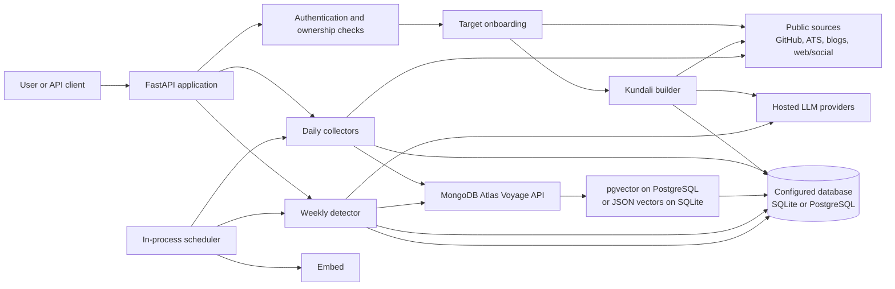
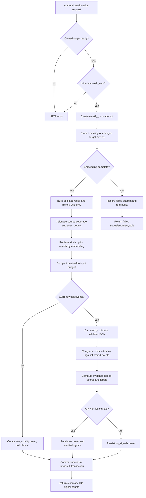

# RAVN System Design

This document describes the implemented backend architecture, data model, and runtime flows in this repository. It reflects the code as currently implemented; planned UI, narrator, and PDF capabilities are called out separately.

## 1. System at a glance

RAVN is a FastAPI competitive-intelligence backend. It lets an authenticated user register a target company, discover and confirm public-source URLs, build a baseline profile (Kundali), collect new events over time, and run weekly analysis over evidence already stored in the configured database.

The application is the coordinator. Public-source fetchers gather evidence; SQLAlchemy persists it; hosted services provide LLM inference and embeddings. The Voyage API creates vectors, but RAVN stores those vectors in its own database.



## 2. Runtime components

| Component | Responsibility |
|---|---|
| `app/main.py` | Creates the FastAPI application, registers routers, starts the scheduler and startup catch-up threads. |
| `app/auth/` | Signup/login, bcrypt password hashing, JWT creation/validation, and current-user dependency. |
| `app/targets/` | Finds candidate company URLs, classifies them, stores confirmed target configuration, and starts or rebuilds its baseline. |
| `app/kundali/` | Gathers a Day-0 snapshot from configured sources and optionally synthesizes it into a strategic dossier. |
| `app/daily/` | Fetches daily source changes, normalizes dates and event payloads, deduplicates items, and stores event and source-summary records. |
| `app/embeddings/` | Prepares deterministic event text, calls hosted Voyage embeddings, and incrementally stores model/version-tagged vectors. |
| `app/weekly/` | Builds evidence windows, computes coverage/counts, retrieves similar historical events, calls and validates the weekly LLM, verifies citations, scores signals, and persists results. |
| `app/scheduler/` | Schedules daily collection and weekly analysis, runs bounded catch-up, and schedules retries for retryable weekly failures. |
| `app/llm/` | Shared provider client used by Kundali synthesis and other general LLM features. The weekly LLM stage pins its configured model and disables provider fallback. |
| `app/export/` | PDF export module is currently a placeholder; PDF export is not implemented. |

### External services

| Service | Use |
|---|---|
| GitHub API | Public organization/repository metadata, languages, commit history, and daily commits. Optional `GITHUB_TOKEN` may be used for API authentication. |
| ATS and company public websites | Job postings and career pages; supported adapters include Greenhouse, Lever, Ashby, and Workable where their public endpoints are available. |
| Blog feeds/pages and public social/update pages | Daily public updates, collected by the source-specific fetchers. |
| Voyage by MongoDB Atlas | Hosted `voyage-4-lite` embeddings; configured by `VOYAGE_API_KEY`. No embedding model is bundled locally. |
| LLM providers | Kundali synthesis uses the shared provider-routing client. Weekly analysis uses the configured weekly model through the client, with fallback disabled for that call. |
| Supabase PostgreSQL | Optional/current hosted database deployment described by the project docs; PostgreSQL uses pgvector for vector storage and retrieval. |

The exact active database is determined at runtime by `DATABASE_URL`. If it is unset, the application defaults to `sqlite:///./ravn.db`. The same environment setting is used by Alembic when applying migrations.

## 3. Application and request flow

```mermaid
sequenceDiagram
    actor U as User/API client
    participant API as FastAPI
    participant Auth as Auth/ownership
    participant DB as SQLAlchemy database
    participant Fetch as Source fetchers
    participant Embed as Voyage embedding client
    participant LLM as LLM provider

    U->>API: Signup/login
    API->>DB: Create user / load password hash
    API-->>U: Bearer JWT
    U->>API: Preview company URL
    API->>Fetch: Discover homepage/about/careers/blog links
    API->>LLM: Classify discovered links
    API-->>U: Candidate source URLs
    U->>API: Confirm target (optionally sync build)
    API->>Auth: Validate JWT and associate target with user
    API->>DB: Insert target (building)
    API->>Fetch: Build baseline snapshot
    Fetch->>DB: Save Kundali raw fields
    Fetch->>LLM: Synthesize baseline dossier
    API->>DB: Mark target ready
    API-->>U: Target/Kundali status
    U->>API: Collect daily / run weekly
    API->>Auth: Validate JWT and target ownership
    API->>DB: Read/write events, embeddings, summaries, weekly records
    API->>Fetch: Collect public-source changes (manual daily endpoint)
    Note over API,Embed: Scheduled daily jobs also embed after collection; manual daily collection does not.
    API->>Embed: Weekly run creates missing/stale vectors
    API->>LLM: Analyze assembled weekly evidence when events exist
    API-->>U: Collection report or weekly run summary
```

### 3.1 Authentication and target setup

1. `/auth/signup` stores an email and bcrypt password hash. `/auth/login` checks the password and returns a JWT.
2. Protected target, daily, and weekly routes resolve the JWT to a user and scope access to that user's target.
3. `/targets/preview` fetches the submitted homepage and fallback pages, extracts links, and asks the LLM to classify links into GitHub, ATS, blog, and web/social URLs.
4. `/targets` saves user-confirmed links in `targets`. It starts the baseline build synchronously with `sync=true`, or as a FastAPI background task otherwise.
5. The Kundali builder fetches baseline GitHub repository languages, commit activity/recent commits, current ATS postings, blog posts, and web/social content. It saves the snapshot in `kundali`. LLM synthesis is best-effort; raw baseline data can still be saved if synthesis fails. Target status moves from `building` to `ready`, or to `failed` if the build fails.

### 3.2 Daily collection

Daily collection runs for each ready target at 23:59 Asia/Kolkata, and can also be requested through `POST /targets/{target_id}/daily/collect`.

For each configured source, the collector:

1. Fetches source candidates for the selected Asia/Kolkata date.
2. Normalizes dates and filters dated items outside the date window.
3. Tracks already-known, failed, and capped ATS/blog lookups for coverage reporting.
4. Deduplicates by `(target_id, source_type, source_key)`.
5. Stores new evidence in `events`, recording whether it is source-dated or first-observed.
6. Upserts a per-target/source checkpoint and per-target/date/source collection summary.
7. The daily collection operation itself does not create embeddings. The scheduled collection job and startup catch-up call the embedding service after collection; embedding failures are logged and do not turn completed collection into a failed collection. A manual weekly run also fills missing or changed embeddings before analysis.

The first undated ATS/blog snapshot is treated as baseline rather than new weekly activity. A first web/social snapshot is also baseline. Historical catch-up can recover dated sources, but cannot recreate past snapshots or undated observations.

### 3.3 Weekly analysis

Manual analysis is exposed by `POST /targets/{target_id}/weekly/run`; scheduled analysis runs on Monday at the configured time (default 03:00 Asia/Kolkata) for the last closed week.



Important behavior:

- The weekly endpoint does not scrape current data; it analyzes records already stored by onboarding and daily collection.
- `week_start` is a Monday. The selected event window is Monday–Sunday in Asia/Kolkata.
- The default history window is 12 previous weeks. Retrieval stays within the same target and uses only previous-week events as matches; current-week embeddings provide query vectors.
- Input compaction shortens text and reduces retrieved examples when required. It does not intentionally drop current-week event evidence; if the payload cannot fit, input building fails.
- A week with no eligible current-week events bypasses the LLM and produces `low_activity`.
- LLM output is constrained to a JSON schema. The application verifies event IDs, target, time window, current-week citation, and source claims. Scores and labels are calculated by application code from verified evidence.
- Failures are retained as run attempts and do not replace an earlier successful result. Scheduled retry is limited to retryable errors.
- The in-process weekly lock and APScheduler are not distributed coordination: multiple server processes need deployment-level coordination to avoid duplicate jobs or API-key rate-limit contention.

### 3.4 Replay and inspection

`scripts/build_weekly_input.py` prints the assembled evidence payload for a target/week. `scripts/replay_weekly.py` replays recent closed weeks for evaluation and writes a report; replay does not write weekly run/result rows, but it can create missing embeddings. The fake replay LLM is the default; `--live` enables a live weekly LLM call.

## 4. Database design

The schema is managed by Alembic and declared in SQLAlchemy models. The repository head is the migration currently in source control; it does not prove which migration has already been applied to a particular live database. Run Alembic against the intended `DATABASE_URL` to inspect/apply that database's revision.

### 4.1 Entity relationship diagram

```mermaid
erDiagram
    USERS ||--o{ TARGETS : owns
    TARGETS ||--o| KUNDALI : has_baseline
    TARGETS ||--o{ EVENTS : collects
    TARGETS ||--o{ DAILY_SOURCE_CHECKPOINTS : tracks
    TARGETS ||--o{ DAILY_SOURCE_SUMMARIES : summarizes
    EVENTS ||--o{ EVENT_EMBEDDINGS : embedded_as
    TARGETS ||--o{ WEEKLY_RUNS : attempts
    TARGETS ||--o{ WEEKLY_RESULTS : has_result
    WEEKLY_RUNS o|--o| WEEKLY_RESULTS : latest_success
    WEEKLY_RESULTS ||--o{ WEEKLY_SIGNALS : contains

    USERS {
        int id PK
        string email UK
        string password_hash
        datetime created_at
    }
    TARGETS {
        int id PK
        int user_id FK
        string name
        string website_url
        string github_url
        string ats_url
        string blog_url
        string web_social_url
        string status
        datetime created_at
    }
    KUNDALI {
        int id PK
        int target_id FK_UK
        json tech_stack
        json cadence_baseline
        json recent_commits
        json ats_postings
        json web_social_status
        json blog_status
        json focus_areas
        datetime created_at
    }
    EVENTS {
        int id PK
        int target_id FK
        string source_type
        string source_key
        string title
        string url
        text raw_content
        string one_liner
        date collection_date
        datetime event_date
        boolean is_baseline
        string date_basis
    }
    DAILY_SOURCE_CHECKPOINTS {
        int id PK
        int target_id FK
        string source_type
        datetime last_success_at
        string last_content_hash
        datetime undated_items_baselined_at
    }
    DAILY_SOURCE_SUMMARIES {
        int id PK
        int target_id FK
        date collection_date
        string source_type
        string status
        int event_count
        int candidates_total
        int known_items
        int failed_items
        int cap_skipped_items
        int not_checked_items
        text highlight
        text error
    }
    EVENT_EMBEDDINGS {
        int id PK
        int event_id FK
        string model_id
        int dimension
        string prep_version
        string text_hash
        vector_or_json embedding
        datetime created_at
    }
    WEEKLY_RUNS {
        int id PK
        int target_id FK
        date week_start_date
        int attempt
        string status
        boolean retryable
        json input_json
        text raw_output
        text error
        int input_token_estimate
        int prompt_tokens
        int completion_tokens
    }
    WEEKLY_RESULTS {
        int id PK
        int target_id FK
        date week_start_date
        int latest_successful_run_id FK
        json source_states
        json exact_counts
        string status
        text summary
        json data_limitations
        boolean limited_history
    }
    WEEKLY_SIGNALS {
        int id PK
        int result_id FK
        string title
        text description
        float score
        json sources
        json signal_types
        json cited_event_ids
        json source_states
    }
```

The Mermaid diagram shows principal keys and relationships. Some IDs are persisted in JSON fields (for example `cited_event_ids`) rather than represented as relational foreign keys.

### 4.2 Table responsibilities and constraints

| Table | Purpose and important constraints |
|---|---|
| `users` | Account identity and password hash; email is unique. |
| `targets` | User-owned company and confirmed source URLs; `user_id` references `users`. Target status includes the build lifecycle. |
| `kundali` | One baseline snapshot per target; `target_id` is unique and references `targets`. Several baseline payloads are JSON. |
| `events` | Normalized daily evidence. Uniqueness on `(target_id, source_type, source_key)` provides source-level deduplication. Baseline records are excluded from weekly evidence. |
| `daily_source_checkpoints` | Current collection checkpoint per target/source; unique on `(target_id, source_type)`. |
| `daily_source_summaries` | Per-date/per-source status, activity highlights, and ATS/blog coverage counters; unique on `(target_id, collection_date, source_type)`. |
| `event_embeddings` | Derived vector for an event/model/text-preparation version; unique on `(event_id, model_id, prep_version)`. PostgreSQL stores `vector(256)`; SQLite uses JSON. The migration to Voyage clears incompatible prior vectors while preserving events. |
| `weekly_runs` | Append-only attempt history for each target/week; unique on `(target_id, week_start_date, attempt)`. Stores status, retryability, model metadata, input/output, usage, rejected proposals, and error. |
| `weekly_results` | One latest result per target/week; unique on `(target_id, week_start_date)`. Points to the latest successful run. |
| `weekly_signals` | Verified signal records belonging to a weekly result; the result relationship cascades on deletion. Source/event references are also captured in JSON. |

### 4.3 Database deployment options

| Runtime database | How selected | Embedding representation |
|---|---|---|
| Local SQLite | Default `DATABASE_URL=sqlite:///./ravn.db` (or any SQLite URL) | JSON vector values; similarity is calculated in Python. |
| Hosted PostgreSQL / Supabase | Set `DATABASE_URL` to the PostgreSQL connection URL | pgvector `vector(256)`; similarity search uses PostgreSQL cosine distance. |

Alembic migrations create/update the same selected database; there is not a separate “local Alembic schema” and “Supabase schema.” They are separate database instances that can be at different migration revisions. `alembic upgrade head` applies migrations to the selected URL. Voyage is a hosted inference API and does not own the RAVN relational tables or vectors.

## 5. Main API surface

| Area | Routes (representative) | Role |
|---|---|---|
| Auth | `/auth/signup`, `/auth/login`, `/auth/me` | Create account, obtain token, verify identity. |
| Targets/Kundali | `/targets/preview`, `/targets`, `/targets/{id}`, `/targets/{id}/kundali/*` | Discover/confirm source URLs, check build state, read raw/synthesized baseline, rebuild. |
| Daily | `/targets/{id}/daily/collect`, `/daily/events`, `/daily/summaries` | Collect sources and inspect saved events/statuses. |
| Weekly | `/targets/{id}/weekly/run`, `/weekly`, `/weekly/{week_start}`, `/weekly/{week_start}/runs` | Run, inspect, and audit weekly analysis/results. |

Target-specific endpoints require bearer authentication and enforce ownership. The interactive OpenAPI UI is provided by FastAPI at `/docs`.

## 6. Operational behavior and boundaries

- **Schedulers are in-process.** APScheduler uses an in-memory job store; startup catch-up and retry tasks are local to the running application process.
- **Weekly rate limiting is process-local.** It does not coordinate Voyage use across app replicas or unrelated clients sharing the API key.
- **No local embedding model is installed.** Event embeddings require network access and a valid hosted Voyage API key when missing/stale vectors must be generated.
- **Collection and analysis are distinct.** Weekly analysis reads persisted events; it does not itself fetch fresh public-source events.
- **LLM output is not treated as ground truth.** Weekly citations are verified and scores/labels are derived by code.
- **Planned modules are not active pipeline stages.** `app/weekly/narrator/` files are empty placeholders; the weekly narrator and `app/export/pdf.py`/PDF export are not implemented. There is no frontend/dashboard implementation in the repository described by the project status.
- **Failures remain inspectable.** Daily source failures are recorded independently in summaries. Weekly failures are recorded as attempts, with retryability used by scheduled retry logic.

## 7. Useful code entry points

- App wiring: `app/main.py`
- Runtime DB selection: `app/db/database.py`
- ORM models: `app/auth/models.py`, `app/targets/models.py`, `app/kundali/models.py`, `app/events/models.py`, `app/weekly/models.py`
- Target setup: `app/targets/routes.py`, `app/targets/onboarding.py`, `app/kundali/synthesis.py`
- Daily flow: `app/events/routes.py`, `app/daily/collectors.py`, `app/daily/fetchers/`
- Embeddings: `app/embeddings/model.py`, `app/embeddings/service.py`
- Weekly flow: `app/weekly/routes.py`, `app/weekly/detector.py`, `app/weekly/input_builder.py`
- Schedulers: `app/scheduler/jobs.py`
- Schema history: `alembic/versions/`
