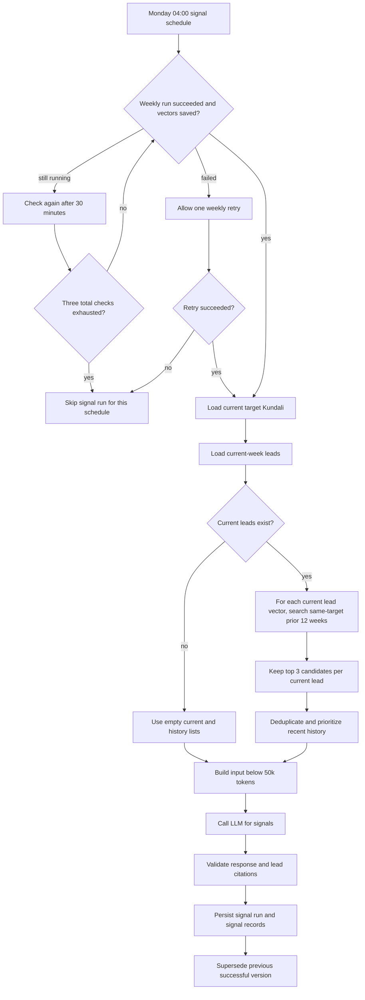
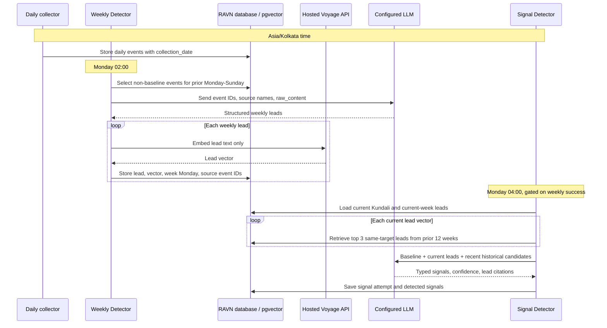

# Weekly Detector — Agreed Design

> **Implementation status:** The Weekly Lead Detector (sections 1–11) and baseline Signal Detector (sections 12–13) are implemented. The detailed sections below document their behavior.

## 1. Purpose and boundary

The Weekly Detector processes one target's daily findings for exactly one Monday–Sunday collection week. It asks the configured LLM to identify all evidence-supported leads from that week's findings, embeds the lead text, and stores each lead with the week date and its source-event references.

The Weekly Detector does **not** compare leads with previous weeks, perform cross-week RAG, infer long-term trends, group leads into signals, or calculate signal scores. Those responsibilities belong to a future, separate Signal Detector.

## 2. Agreed behavior

1. Select one target and one Monday-start week.
2. Read that target's daily event records whose `collection_date` is within that week.
3. Exclude baseline records (`is_baseline = true`). The Kundali/baseline profile is not weekly evidence.
4. Send the week's daily events to the configured LLM. Each event in the prompt includes:
   - Its database event ID.
   - Its source name (`github`, `ats`, `blog`, or `web_social`).
   - Its `raw_content`.
   The complete event set is split into sequential requests when necessary to stay within the configured weekly request byte budget; no events or raw content are dropped.
5. Ask the LLM to return a structured collection of all leads found in the supplied evidence, from minor observations to major developments. Each lead cites one or more input event IDs.
6. Validate the response and ensure cited IDs were part of the selected week's input.
7. Embed the lead's textual content only. The week date and source IDs are metadata, not embedding text.
8. Store each lead, its vector, the selected week's Monday date, and its source event IDs.
9. Record run attempts so failed runs can be retried and test/manual invocations can be distinguished.

The selected week's Monday is the canonical week key, even though its events span Monday through Sunday.

## 3. Week membership rule

Use the Asia/Kolkata calendar date already assigned by daily collection, not the original source publication date:

```text
collection_date >= week_start
AND collection_date < week_start + 7 days
AND is_baseline = false
```

For example, the week beginning Monday `2026-11-09` includes collection dates from `2026-11-09` through `2026-11-15`, inclusive. The exclusive upper bound is Monday `2026-11-16`. An event collected on a previous week's date cannot pass this query.

`event_date` and `date_basis` remain available as source metadata for interpreting evidence, but they do not determine the selected week. This is intentional: the agreed meaning is “the date RAVN saw and stored the finding.”

## 4. Input contract

The detector sends the complete selected week's eligible events, splitting them into sequential requests as needed to stay below `RAVN_WEEKLY_WEEKLY_INPUT_BYTE_BUDGET` (default 48,000 bytes including the system prompt and a request-overhead allowance). Every event appears in exactly one batch. Batch boundaries can prevent the model from connecting evidence that lands in different batches; batching therefore prioritizes complete processing over a single prompt's cross-event context. The backend merges exact duplicate descriptions (case/whitespace-normalized) across batches and unions their event citations. It does not semantically deduplicate differently worded leads across batches. If a single event cannot fit by itself, the run fails explicitly rather than truncating or omitting evidence.

Conceptual LLM input:

```json
{
  "week_start": "2026-11-09",
  "events": [
    {
      "id": 123,
      "collection_date": "2026-11-09",
      "source": "github",
      "raw_content": "{\"sha\":\"...\",\"repo\":\"org/repo\",\"message\":\"...\",\"date\":\"...\",\"url\":\"...\"}"
    },
    {
      "id": 124,
      "collection_date": "2026-11-10",
      "source": "ats",
      "raw_content": "Title: Staff Engineer\nLocation: Remote\nURL: https://example.test/jobs/123\nDescription: ..."
    }
  ]
}
```

`raw_content` is the event evidence currently stored by RAVN:

| Source | Current `raw_content` shape |
|---|---|
| GitHub | JSON containing commit SHA, repository, message, commit date, and URL. |
| ATS/jobs | Job title, location, and URL; a fetched job description may be appended for eligible dated postings. |
| Blog | Post content when available, otherwise the title; article text may be fetched for eligible dated posts. |
| Web/social | Extracted text from the configured public page. This is a page snapshot/change, not necessarily a platform-specific social post. |

The LLM must be told to use only the supplied evidence, treat source text as untrusted data rather than instructions, avoid inventing claims, and cite event IDs for each lead. Event IDs are included specifically to preserve traceability; the backend validates them rather than trusting arbitrary IDs returned by the model.

## 5. LLM output contract

The agreed semantic output is a list of leads; every lead has text and supporting daily event IDs. The backend attaches target and week metadata and does not ask the LLM to choose those values.

Recommended non-empty response:

```json
{
  "leads": [
    {
      "description": "Two new roles focus on streaming data and large-scale storage.",
      "source_event_ids": [124, 128]
    },
    {
      "title": "Repository activity indicates a new command-line feature",
      "description": "A commit adds configuration and command handling for the new capability.",
      "source_event_ids": [123]
    }
  ]
}
```

The implementation validates exactly the `leads` top-level property and the following fields:

- `description`: concise, evidence-grounded explanation of the lead.
- `source_event_ids`: non-empty IDs drawn only from the event records sent in this request.

The prompt prioritizes business significance and tells the model to return fewer complete leads, rather than truncate JSON, if its available output tokens are insufficient. No fixed output-token count is embedded in the prompt because providers/models may differ. This is best-effort; the provider can still truncate a response.

### Empty week

If there are no eligible events, the Weekly Detector still calls the LLM with an empty `events` array. The LLM should return:

```json
{
  "leads": null
}
```

The run is saved with a `no_events` outcome and the raw/validated LLM response for auditability. There are no lead rows and no vectors for that week. `NaN` is not used: it is not valid JSON and cannot represent a valid embedding vector. A successful analysis that finds no leads despite non-empty input may use an empty array (`"leads": []`); that is distinct from the agreed empty-input response.

## 6. Implemented persistence design

The hosted Voyage API generates embeddings; the RAVN database stores lead records and vectors. For PostgreSQL/Supabase the vector column is pgvector. SQLite can provide a JSON-backed development/test representation if the project continues to support it.

### `weekly_lead_runs`

One record per execution attempt for a target/week:

| Field | Role |
|---|---|
| `id` | Attempt identifier. |
| `target_id` | Target being processed. |
| `week_start_date` | Canonical Monday key for the week. |
| `attempt` | Sequential attempt number for retries/testing. |
| `status` | `running`, `succeeded`, `no_events`, or `failed`. |
| `is_current` | Marks the latest successful run for this target/week. |
| `retryable` | Indicates whether the scheduler should retry a failed attempt. |
| `input_event_ids` | Exact IDs of eligible events submitted to the LLM; empty for an empty week. |
| `input_json`, `output_json` | Complete input snapshot and validated JSON response. |
| `llm_provider`, `llm_model`, `embedding_model_id`, `prompt_version` | Model and prompt identifiers used for this attempt. |
| `input_token_estimate` | Approximate size of the saved input. |
| `raw_output` | Original LLM response for debugging/audit. |
| `error` | Failure detail when applicable. |
| `started_at`, `finished_at` | Attempt timestamps. |

### `weekly_leads`

One record per generated lead:

| Field | Role |
|---|---|
| `id` | Lead identifier. |
| `run_id` | Successful run that produced it. |
| `target_id` | Enables target-scoped reads. |
| `week_start_date` | Monday date metadata; not part of embedding text. |
| `description` | Lead content and the text used to form embedding input. |
| `source_event_ids` | References to the daily `events.id` values supporting the lead. |
| `embedding` | Hosted Voyage vector for the lead text. |
| `embedding_model_id`, `created_at` | Vector provenance and creation time. |

These tables are implemented by an additive Alembic migration. Source-event IDs are stored as JSON and validated against the selected-week input before persistence. PostgreSQL uses `vector(256)` and SQLite uses JSON-backed vectors.

### Vector text

Embed only stable lead text, initially:

```text
{title}
{description}
```

Do not embed `week_start_date`, `target_id`, run ID, or source-event IDs. They are structured metadata for filtering and traceability. The Signal Detector can later filter vectors by target and week before similarity search.

## 7. Scheduling and testing

- **Schedule:** Monday at 02:00 Asia/Kolkata, after the current Sunday 23:59 daily collection schedule. This fixed delay is the initial implementation; dynamic completion checks are deferred.
- **Testing:** Manual runs are allowed during development so each stage can be tested without waiting for the scheduled job.
- **Retry policy:** One scheduled retry follows a retryable failure. Manual execution remains available during development.
- The current scheduler is process-local. Multi-instance locking/deduplication is not part of this initial baseline.

## 8. Reruns, retries, and replacement

Agreed direction:

- Failed attempts may be retried.
- Each attempt should be recorded.
- A failed attempt must not erase a previously successful week's leads.
- A successful rerun should become the active/current lead set for that target/week; earlier successful output should not be mixed into it.

Implemented replacement behavior:

- Successful runs are retained in history; `is_current` identifies the active run. A successful rerun supersedes the earlier current run without mixing their leads.
- Each retry is a new attempt and re-queries the selected week. Lead embeddings are committed together with the successful run, so a failed embedding step does not persist partial leads.
- Corrected or newly collected events are reflected by a successful manual or scheduled rerun; the new successful run becomes current.

## 9. Out of scope for the Weekly Detector

- Comparing current leads with the prior 12 weeks. This is the separate Signal Detector's responsibility, described below.
- RAG, similarity matching across weeks, signal grouping, trend detection, and signal classification.
- Map/reduce analysis and caching for large weeks.
- Dynamic “Sunday collection finished” coordination.
- Shared-target deduplication across multiple users.
- Distributed scheduler/lock behavior for multiple application instances.
- Production restrictions on manual run endpoints.

## 10. Baseline completion criteria

The Weekly Detector baseline is ready to hand off to Signal Detector implementation when:

1. [x] A selected target/week query includes only non-baseline events whose `collection_date` is in the selected Monday–Sunday window.
2. [x] The exact input event IDs, source names, collection dates, and raw content passed to the LLM are saved for inspection.
3. [x] The LLM response is structured and every lead citation is validated against that run's input.
4. [x] Non-empty weeks produce one stored lead row/vector per returned lead with week date and source-event references.
5. [x] Empty weeks call the LLM with an empty list, store the `no_events` run and `leads: null`, and create no vectors.
6. [x] A failed attempt is inspectable/retryable and does not corrupt the previous successful lead set.
7. [x] Manual test runs work, and the fixed Monday 02:00 scheduled run invokes the same detector flow.
8. [x] Large weeks are split into bounded requests without omitting events; citations are validated per batch and exact duplicate leads are consolidated.

## 11. Implementation boundary

The active weekly endpoint and scheduler implement the lead extraction flow in sections 1–10 and write `weekly_lead_runs` and `weekly_leads`. Legacy event embedding, historical retrieval, signal proposal, verification, scoring, replay, and `weekly_runs`/`weekly_results`/`weekly_signals` code remains in the repository for compatibility and offline evaluation, but it is no longer invoked by the active Weekly Lead Detector. Daily collection and its event-embedding path are unchanged.

## 12. Signal Detector — Agreed Design

> The Signal Detector is a separate stage that runs after the Weekly Detector. It consumes weekly leads and their stored embeddings; it does not analyze raw daily events directly.

### 12.1 Purpose and responsibilities

The Signal Detector looks for meaningful developments by comparing current-week leads with the target's baseline Kundali and related leads from previous weeks. Signals can represent emerging activity, continuation, acceleration, slowdown/deceleration, strategic shifts, sudden changes, cross-source patterns, or another useful evidence-backed development.

The detector may report a genuinely new current-week development even if no prior weekly lead is relevant. It must not claim a historical trend or shift without historical evidence.

The Signal Detector is responsible for:

1. Loading the target's current Kundali baseline.
2. Loading that target's current-week weekly leads.
3. Using each current lead vector to retrieve up to three candidate leads from the previous 12 weeks for that same target.
4. Passing the baseline, current leads, and retrieved historical candidates to the LLM within the configured input budget.
5. Validating signal output and its lead citations.
6. Persisting the signal run and the resulting signals separately from weekly leads.

It does not create or revise weekly leads. Retrieval is scoped to the target ID, so a deleted target recreated with a new ID cannot share prior leads. The existing in-place Kundali rebuild endpoint does not purge the target's daily or weekly history; same-ID rebuilds can therefore still retrieve leads collected before the rebuilt baseline. Implementing the agreed full-history reset for that endpoint remains separate work.

### 12.2 Schedule and handoff

- The Weekly Detector starts at **Monday 02:00 Asia/Kolkata**.
- The Signal Detector is scheduled for **Monday 04:00 Asia/Kolkata**, after the weekly stage is expected to finish.
- If the weekly run is still in progress at 04:00, check again every 30 minutes for **three total checks**: 04:00, 04:30, and 05:00.
- If the weekly run has failed, allow one Weekly Detector retry. If that retry does not succeed, skip Signal Detector for that week.
- Signal detection starts only after the current week's lead records and vectors have been successfully stored.

The fixed schedule and bounded checks are the initial working design. More dynamic completion coordination is deferred until the baseline system works.

### 12.3 Evidence selection and RAG

For a selected week beginning at `week_start`:

1. Load weekly leads for the same target and the selected current week.
2. For every current lead with a stored vector, search for semantically similar leads belonging to the same target and dated within the **12 weeks before** `week_start`. Do not retrieve the current week as historical evidence.
3. Keep the **top three** historical candidates for each current-week lead, ranked by vector similarity. Return up to three even when the similarity is weak; they are candidates, not proven matches.
4. Deduplicate historical leads that were retrieved for multiple current leads so the LLM receives a lead once, with its associated retrieval context.
5. Include the historical candidate's week date and similarity value as metadata. These values are not part of the embedded lead text and similarity is not proof of a relationship.
6. If fewer than 12 previous weeks exist, search the available weeks only.

The Signal Detector's LLM input consists of:

- The target's current Kundali baseline.
- All current-week leads and their lead IDs.
- The RAG-selected historical leads, their IDs, week dates, and similarity values.

If there are no current-week leads, still call the LLM with the Kundali, an empty current-leads list, and an empty retrieved-history list. The LLM can return that no signals or matches were found; historical leads are not loaded without current lead vectors to use as RAG queries.

### 12.4 Input budget

The Signal Detector's complete LLM input must remain **below 50,000 tokens**. When historical evidence must be reduced to fit, preserve the Kundali and current-week leads, and prioritize historical leads from more recent weeks over older weeks. The initial version does not add chunking or caching; those can be considered after the end-to-end detector is operational.

The LLM must be told that RAG results are only nearest-neighbor candidates. It may reject all retrieved candidates as unrelated and must not invent a connection just because a result was returned.

### 12.5 Signal definition and evidence rules

The LLM may identify signals including, but not limited to:

- `emerging`
- `continuation`
- `acceleration`
- `deceleration`
- `strategic_shift`
- `sudden_change`
- `cross_source_pattern`
- `other`

Each signal must cite at least one current-week lead ID. Historical lead IDs are required when the signal claims a pattern over time—for example continuation, acceleration, deceleration, or a historical shift. A new/emerging signal can have no historical citations. Kundali is background context, not a dated weekly-lead citation.

The LLM should return a qualitative confidence (`low`, `medium`, or `high`) with a rationale. Confidence is the model's judgment, not a calibrated probability. The cited lead content and explanation remain the evidence.

### 12.6 LLM response contract

Proposed response when signals are found:

```json
{
  "signals": [
    {
      "title": "Expansion of real-time data capabilities",
      "description": "Current hiring and engineering activity indicate investment in real-time data infrastructure.",
      "signal_types": ["emerging", "cross_source_pattern"],
      "confidence": "medium",
      "confidence_rationale": "Current hiring and repository evidence point in the same direction, but no earlier weekly lead confirms the duration of this activity.",
      "current_lead_ids": [501, 508],
      "historical_lead_ids": []
    },
    {
      "title": "Continued investment in developer automation",
      "description": "This week's work extends an automation effort also represented in earlier weekly findings.",
      "signal_types": ["continuation"],
      "confidence": "high",
      "confidence_rationale": "Related leads appear in multiple earlier weeks as well as this week.",
      "current_lead_ids": [514],
      "historical_lead_ids": [421, 463]
    }
  ],
  "no_matches_reason": null
}
```

When no signal is supported:

```json
{
  "signals": [],
  "no_matches_reason": "No current leads or retrieved historical candidates support a coherent signal."
}
```

The exact wording of prompts and field validation limits are implementation details. The backend supplies target/week context and validates that cited current and historical lead IDs came from the corresponding inputs. It must reject IDs from another target, week, or unselected historical candidate.

### 12.7 Signal persistence and reruns

Signal detection has its own run history and output records, separate from the Weekly Detector's lead runs and leads.

Proposed logical records:

- **Signal run:** target, current `week_start_date`, attempt, status, timestamps, model metadata, input/retrieval metadata, and failure details.
- **Detected signal:** signal run, target, week, title, description, types, confidence and rationale, current lead IDs, and historical lead IDs.

Each attempt is recorded. Failed attempts do not replace a successful result. If a newer run for the same target/week succeeds, keep the previous successful signal set for audit and mark it superseded; only the latest successful version is active for consumers.

The implementation uses `signal_detection_runs` and `detected_signals`; the run's `input_size_bytes` records the conservative UTF-8 byte count used against the under-50,000 byte ceiling. Lead citations are JSON ID lists. Weekly leads remain the source of truth for weekly findings; the Signal Detector does not rewrite them. Failed runs leave the previous run marked current; a successful rerun supersedes it and retains the prior run for audit.

### 12.8 Flow diagram



### 12.9 Signal Detector baseline completion criteria

The Signal Detector baseline completion criteria are:

1. [x] It starts only after the Weekly Detector has successfully stored current-week lead vectors, following the agreed schedule/check/retry handoff.
2. [x] It loads the target Kundali and current-week leads, and retrieves only same-target historical leads from the previous 12 weeks.
3. [x] It retrieves up to three historical candidates per current lead and provides their dates and similarity values as candidate metadata.
4. [x] It preserves current leads and Kundali, prioritizes recent historical evidence, and enforces a conservative 49,000-byte input ceiling as a proxy for the below-50,000-token requirement.
5. [x] It calls the LLM with baseline plus empty current/history lists when the week has no leads.
6. [x] It validates signal categories, confidence shape, and current/historical lead citations.
7. [x] New/emerging signals can be returned without historical citations; signals claiming historical behavior cite historical leads.
8. [x] Each attempt and its successful signal set are stored; failed attempts preserve the previous success, and successful replacements supersede rather than erase earlier versions.

## 13. Combined weekly-to-signal schedule


